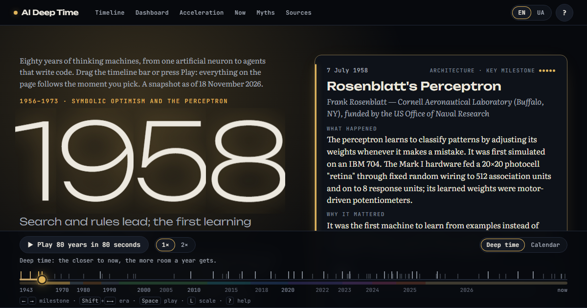

# AI Deep Time

**[Open the timeline →](https://nosoccus.github.io/ai-deep-time/)**

[](https://nosoccus.github.io/ai-deep-time/)

An interactive, bilingual (English / Ukrainian) timeline of eighty years of artificial intelligence, from the first artificial neuron (1943) to agents that write code (2026). It has 76 milestones in 13 eras, the model line-ups of the main labs, charts of compute, benchmarks, prices and adoption, 14 architecture diagrams, a "myths and mix-ups" section, and 861 cited sources.

**A snapshot as of 18 November 2026.** The AI-checked research covers 1943 to 9 October 2026; an update pass added 9 October to 18 November 2026 (see `data/update-2026-11-18.js`). The history ages well; the model line-ups, benchmark scores and prices from 2024 on date within months.

## How it was made

The research, the text and the page were produced with AI (Anthropic's Claude), working from public sources. The facts were then checked against the cited sources by AI as well (about 650 claims checked, 68 corrections). The November update came from two AI research passes in which three independent AI verifiers checked each claim (80 claims checked, 70 kept, 10 rejected). **No human expert has reviewed it**, so it may contain errors. Estimates are marked "est.", contested figures carry a caveat, and every milestone, number and chart links to its sources inside the page.

Found a mistake? Please open an issue with the milestone or chart, what is wrong, and a source.

## Using the page

- **Timeline**: drag the playhead along the bar (pinned to the bottom of the screen on phones), or press **Play** to run through all 76 milestones in about 80 seconds. The era text, milestone card, models, charts and diagram all follow the moment you pick.
- **Scale**: the timeline starts on a "deep time" scale that gives recent years more room; switch to **Calendar** to see how little room the last decade really takes.
- **Keyboard** (anywhere on the page, except in the search field or a focused chart): ← → step between milestones, Shift+← → or PgUp/PgDn between eras, Home/End jump to the first and last milestone, Space plays or pauses, L switches the scale. Press **?** for the full list.
- **Language**: the EN / UA switch in the header changes all labels and text.
- **Sources**: each "Sources" button lists the sources behind that item; the full list, with a filter, is at the bottom of the page.

## Running it

It is a static page with no build step and no dependencies: open `index.html` through any web server, for example:

```bash
python -m http.server 8000
```

then go to <http://localhost:8000>.

What is where:

| Path | Contents |
|---|---|
| `index.html` | Page structure and styles |
| `app.js`, `app-charts.js`, `app-panels.js` | The interface: timeline, charts, panels, EN/UK strings |
| `diagrams-a.js`, `diagrams-b.js` | The 14 architecture diagrams, drawn as SVG |
| `data/` | All facts: eras, milestones, models, chart series and sources |
| `fonts/` | Self-hosted Unbounded, Literata and JetBrains Mono |
| `assets/`, `favicon.svg` | The preview image and the tab icon |

The page loads nothing from other sites, uses no cookies or analytics, and only stores your language and chart choice in your own browser.

## Data sources

Every fact carries a source id that the page resolves to a title and link. Chart series draw mainly on [Epoch AI](https://epoch.ai/), [METR](https://metr.org/), [Artificial Analysis](https://artificialanalysis.ai/), the [Stanford AI Index](https://hai.stanford.edu/ai-index) and [Our World in Data](https://ourworldindata.org/artificial-intelligence), each credited on its chart. Benchmark results also come from the [ARC Prize](https://arcprize.org/) and the benchmarks' own leaderboards.

## Licence

- **Code** (`*.js` outside `data/`, `index.html`): [MIT](LICENSE).
- **Original text and data** (`data/`, the diagram labels and the interface text): [Creative Commons Attribution 4.0](LICENSE-CONTENT) (CC BY 4.0). Credit "AI Deep Time" and link to this repository.
- **Not covered**: quotations, which stay with their authors; data taken from the sources above, which stays under its own terms (credit those sources when you reuse it); product names and logos, which are trademarks of their owners.
- **Fonts**: SIL Open Font License 1.1 (see `fonts/OFL-*.txt`).

Not affiliated with, or endorsed by, any AI company or research organisation named here.
